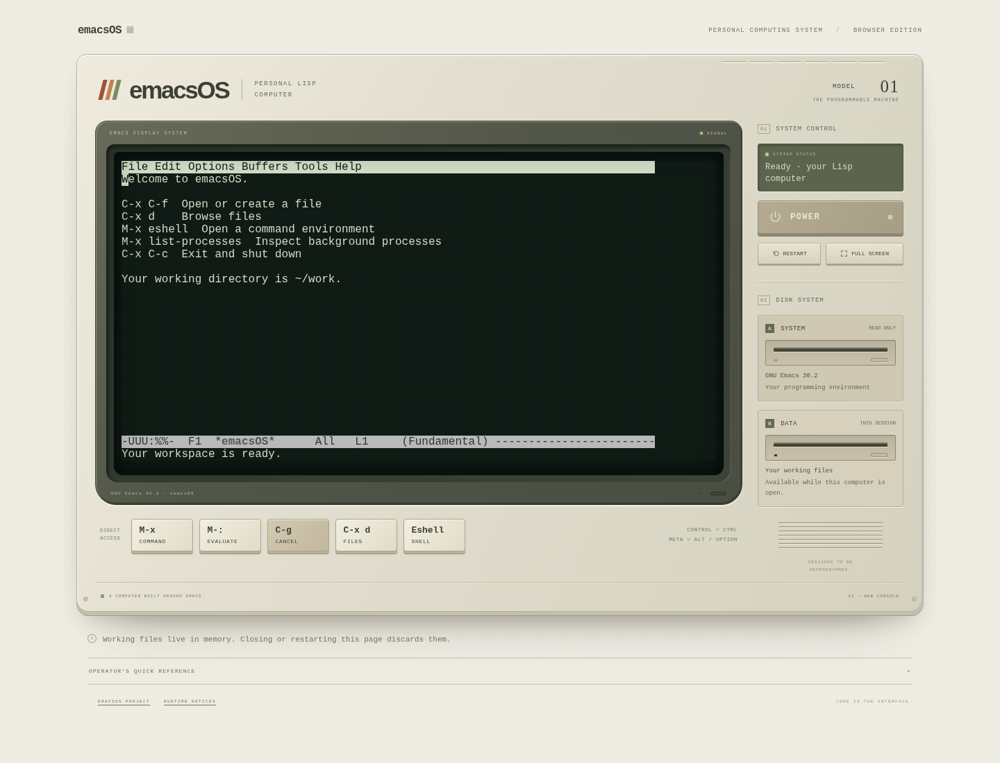
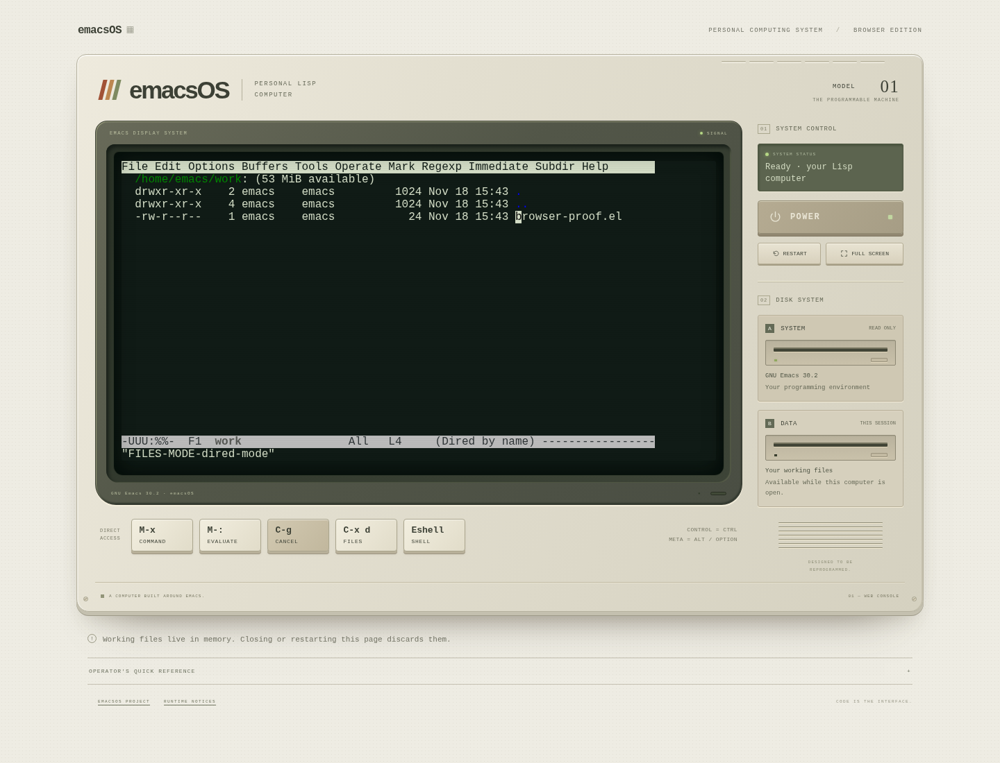

# emacsOS

**Your machine. Your Lisp.**

A personal computer built around GNU Emacs, with a browser for its screen.
Boot a small Linux system, open a real Emacs session, and make the environment
your own: write a note, explore files, run a shell, or turn a Lisp function into
your next tool.



[**Try the live computer →**](https://suxiaogang223.github.io/emacsos/) · [Run locally](#run-it-yourself) · [First five minutes](docs/first-session.md) ·
[Documentation](docs/README.md) · [Roadmap](docs/roadmap.md)

## A computer you can change

The screen is a real 80 × 24 terminal connected to GNU Emacs 30.2 inside
QEMU/WebAssembly. Editing, evaluation and file operations happen in the guest.
Linux supplies the kernel and ordinary files and processes; Emacs is where you
work. The browser supplies the case, screen, keyboard shortcuts and power switch.

There is no separate application framework to learn. A buffer can be an
interface, an interactive Lisp function can be a tool, and a plain text file can
be its data. The project focuses on bringing that style of personal computing
to the Web.

## Start with something small

| Try this | How |
| --- | --- |
| Ask your computer a question | Press **EVALUATE**, enter `(+ 20 22)`, then Enter |
| Write and run your own command | Follow the [first-session walkthrough](docs/first-session.md) |
| Explore your workspace | Press **FILES**, then Enter to open `~/work` in Dired |
| Run a command | Press **SHELL**, wait for the prompt, then enter `echo hello` |

On a Mac, use **Control** for `C-` shortcuts and **Option** for `M-` shortcuts.
`Esc`, then `x`, also opens `M-x`. `C-g` cancels a command.

<details>
<summary>See files inside the running computer</summary>



This is the guest's filesystem, shown by Emacs' built-in Dired. Screenshots
come from actual browser acceptance runs; see [image provenance](docs/images/README.md).

</details>

## Run it yourself

On Linux, install Docker with Linux/amd64 support, Make, Python 3.11+, curl and
e2fsprogs (`mkfs.ext4` and `debugfs`). Then:

```sh
git clone --single-branch --branch main --recurse-submodules https://github.com/suxiaogang223/emacsos.git
cd emacsos
make web
```

Open **http://127.0.0.1:18082/** in a desktop browser and press **POWER**.
The first build compiles the pinned Emacs source; later builds reuse Docker
layers and verified artifacts. Startup can take a few minutes.

The browser needs WebAssembly threads and sufficient memory: the emulator
reserves about **2.25 GiB**, plus page and image overhead. Remote access needs
trusted HTTPS or an SSH tunnel; see [browser hosting](docs/web.md).

**Browser files belong to the current session.** Closing, refreshing or
restarting the page discards them. Browser retention and guest networking are
not implemented yet.

## What works today

| | Browser computer | Native reference |
| --- | --- | --- |
| Runtime | GNU Emacs 30.2 on Linux; runtime files read from SquashFS | The same kernel and userspace |
| Guest RAM | 512 MiB | 1 GiB |
| Files | Writable session disk | Separate host-backed home disk |
| Retention | Until the page closes or restarts | Tested across orderly shutdown and reopening |
| Guest networking | Disabled | QEMU user networking; synchronous HTTPS acceptance |
| User environment | One trusted Emacs and account | One trusted Emacs and account |

For the native console, install `qemu-system-x86_64` and OpenSSL, then use
`make run`. Its home disk is `build/machine/data.ext4`; preserve that file when
cleaning build outputs. Neither profile provides application sandboxing.

This is an experimental project. Native acceptance, browser acceptance and
compilation establish different things; the [acceptance guide](docs/mvp.md)
defines those boundaries. The public runtime is built from pinned sources;
[release and rebuild materials](docs/releasing.md) accompany the binaries.

## Build with us

The next steps are a more useful Emacs workspace, browser workspace continuity,
and a verified browser network transport. See the [roadmap](docs/roadmap.md).
System policy and the Web console live in this repository; `emacs/` pins a
[GNU Emacs fork](https://github.com/suxiaogang223/emacs) that currently adds
provenance only.

- [Documentation map](docs/README.md): choose a reading path.
- [Architecture](docs/design.md): how the browser, Emacs and Linux fit together.
- [Build and test](docs/build-and-test.md): commands, dependencies and evidence.
- [Contributing](CONTRIBUTING.md): ownership, language and PR workflow.

## License and credits

Parent-owned code is licensed under **GPL-3.0-or-later**; see [LICENSE](LICENSE).
GNU Emacs and other third-party components retain their own licenses.
See [licensing and distribution](docs/licensing.md) and
[browser runtime notices](web/licenses.html).

Built on GNU Emacs, Linux, Alpine, BusyBox, QEMU, Emscripten, xterm.js and
xterm-pty. emacsOS brings these pieces together as a personal Lisp computer.
