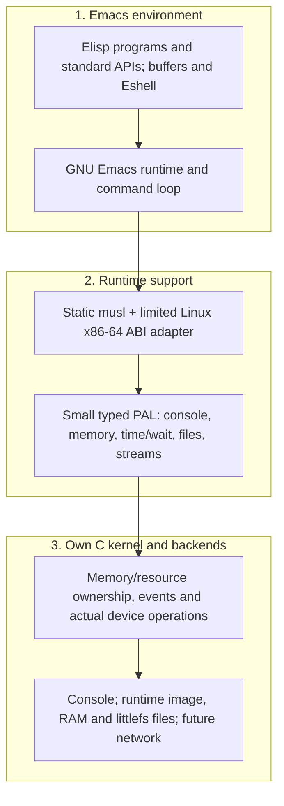

# System architecture

emacsOS aims to make GNU Emacs the machine's programming and operating
environment. Standard Elisp APIs are the public interface; file and network
backends supply actual capabilities. This document describes the selected
architecture. The first bounded port is
implemented; [MVP acceptance](mvp.md) defines the exercised guest subset.

## Current source and proposed system

The parent contains BIOS boot, static ELF loading, page mappings/protection,
serial input/output, PIT/RTC time, readiness waits, a bounded syscall adapter,
and read-only runtime plus volatile and littlefs working files. GNU Emacs executes with its
matching portable dump. Parent-owned Lisp provides cooperative application
management. The fixed DATA disk supplies persistence at `/work`; networking and
isolated execution remain unimplemented. See [storage](storage.md) for disk and
browser-retention boundaries.
The fixed-machine profile and limits are in [kernel bootstrap](kernel-bootstrap.md)
and [files](files.md); the fork itself remains unchanged except provenance.

The [browser console](web.md) runs that same fixed-machine image inside a pinned
QEMU/Wasm runtime, with xterm.js presenting COM1. Its page owns emulator
startup/restart, keyboard input and display; system and application behavior
remain in the guest. There is no terminal-server or host Emacs substitute in
this route. Browser RAM is discarded when the page closes or restarts; completed
DATA checkpoints are retained separately in IndexedDB for the same origin.

The following diagram shows responsibilities; network streams remain future work:



These are three functional responsibilities, with named implementation pieces;
they do not require three new frameworks or independently isolated components.

## First-port decision

Use a statically linked GNU Emacs with musl, served by a limited Linux x86-64
syscall compatibility adapter in our own kernel. The PAL sits below that
adapter and defines backend semantics. This is a bounded compatibility target,
not a Linux kernel, full Linux userspace or general Unix process environment.
The MVP validates this route for its fixed machine and exercised paths.

The initial build profile is terminal-only, using interpreted and bytecompiled
Lisp. GUI, native compilation, Lisp threads, TLS/HTTPS and external helpers are
deferred; [runtime build](runtime-build.md) pins configure options and dependencies.
Functions remaining in a build still need a backend or explicit unsupported
behavior; the profile does not imply all unsupported functions disappear.

This route retains upstream libc/runtime startup and reduces the initial Emacs
port surface. It still requires executable loading, startup-stack and libc
thread-local storage (TLS) setup,
memory operations, readable runtime files, terminal behavior and event waits.
Disabling Lisp threads or transport encryption does not remove libc
thread-local storage and errno initialization. A generic read/write interface
cannot replace them. A direct Emacs C platform
port or replacement libc is deferred because it expands the initial integration
and maintenance work. See [runtime-port requirements](runtime-port.md).

The adapter translates syscall arguments, descriptors and error numbers into
PAL operations. It must not hide unsupported behavior with success-only stubs.
Kernel/backends expose typed operations without Linux syscall layouts; the
adapter consumes those operations. New Elisp wrappers are unnecessary when
standard functions can use the supported runtime path.

## Layer ownership

| Responsibility | Owns | Does not imply |
| --- | --- | --- |
| Emacs environment | Standard Elisp APIs, evaluation, buffers, loading, conditions, command loop and tool clients. | A backend because its function exists; OS processes because a connection object exists. |
| Runtime support | Static musl startup, bounded ABI translation and typed PAL capability/error/lifetime contracts. | Full Linux compatibility, replacement libc or a generic resource broker. |
| Own kernel/backends | Real memory/device access, resource tables, bounds and readiness delivery. | Protection, scheduling or durability before those mechanisms exist. |

Kernel, adapter and future PAL code belong to the parent repository. Necessary
Emacs runtime changes belong to the pinned fork. Future system Elisp and its
tests belong to the parent. Build-time placement inside installed Emacs Lisp
does not change source ownership; see [source layout](source-layout.md).

## Capability contracts

Start with the capabilities needed before interactive Emacs; grow typed file
and network operations from working backends. Concrete bootstrap contracts and
bounds are in the kernel/file headers and
implementation documents; broader operations remain design requirements.

| Capability | Required semantics |
| --- | --- |
| Console | Byte input/output, partial transfer, terminal attributes needed by Emacs, readiness and real device errors. |
| Memory | Available/reserved ranges; aligned allocations/maps with explicit size, lifetime, release and failure rules; define any supported protection semantics honestly. |
| Time/wait | Monotonic time, absolute deadlines, readiness sets, timeout and interruption outcomes; define wake/recheck behavior. |
| Runtime files | Read-only lookup, metadata, open/read/seek/map or a documented equivalent sufficient for executable, dump, Lisp and data loading. |
| Working files | Later typed file/directory operations, creation flags, offsets, metadata, rename, cleanup and synchronization. |
| Network streams | Later connection setup, pending/connected/failed state, byte I/O, readiness, EOF, timeout and close. |

Share read/write/close/wait conventions where meaningful. Keep directory
iteration, rename and connection setup typed rather than forcing them into a
universal operation bag. Do not add a general resource registry or plugin
framework before these concrete contracts need one.

The following operation families are a **design sketch**, not implemented C
signatures or a committed binary ABI:

```text
console_read / console_write / console_attributes
memory_map / memory_unmap
clock_monotonic / wait_ready(interests, absolute_deadline)
file_open / file_read / file_write / file_seek / file_metadata / file_sync
file_rename / file_remove / directory_open / directory_next
after N0: stream_connect / stream_read / stream_write / stream_status
close_file / close_directory / close_stream
```

Every acquired handle has one recorded owner and defined transfer/duplication
rules. Borrowed buffers remain valid for the operation's documented duration;
asynchronous ownership must be explicit. Events carry identity/generation
sufficient to reject stale events after close or handle reuse. The first port
can keep simple owned synchronous operations and nonblocking readiness rather
than hidden background pointer retention. Bound handle counts and queues;
failed acquisition releases
partial resources.

A positive byte count reports progress and can be shorter than requested.
For a nonzero read request, distinguish zero-byte EOF from would-block and a
real error; a zero-length request alone proves no EOF. No-progress writes need
an explicit would-block/error outcome rather than an infinite retry. The
adapter preserves those distinctions as appropriate Emacs conditions/events.

Close consumes the caller's handle even if final cleanup reports an error;
retrying that same handle is invalid. Duplication, if supported, adds a reference
and only final release destroys the underlying resource. Preserve earlier I/O
failure and separately report final cleanup failure as the documented operation
requires. File close is not inherently a durable-storage guarantee.

## Boot and runtime loading

The implemented fixed-machine boot chain follows these requirements:

1. BIOS loads the kernel; x86-64 entry establishes the fixed 1 GiB identity map
   and stack. This is a QEMU machine contract, not general RAM discovery.
2. Kernel initialization accounts for available RAM and reserves page tables,
   kernel sections, stacks, runtime-image backing and future loaded regions.
   Establish console, memory, monotonic time/wait and read-only bootstrap files.
3. Load a supported static Emacs ELF, validating segments, sizes, alignment,
   range arithmetic, overlap and entry placement. Define its initial ABI stack,
   arguments/environment and required libc thread-local storage startup state.
4. Expose the matching portable dump, Lisp and runtime data through bootstrap
   file operations. A read-only image is required before writable user files;
   it is not a persistent working filesystem.
5. Enter a controlled base initialization that avoids accidental user/site
   startup and reaches the command loop. Only then claim interactive Elisp.

The executable, portable dump, source/version, Lisp and runtime data must come
from a matching build, recorded by an artifact manifest. Source pins alone do
not identify a built runtime. The exact toolchain, dump configuration, image
encoding and controlled startup arguments must be selected and validated during
the port. Do not combine an old dump with new dumped Lisp or a new executable.

## Data and event flow

A supported file read follows Elisp file API → Emacs/libc → supported ABI operation
→ typed PAL file operation → backend. Data/count/error returns along that path;
backend limits and original failures remain visible. F0 RAM directories remain
volatile. F1 projects a fixed littlefs DATA volume at `/work`, with file sync and
ATA flush in the guest. Browser retention additionally needs a frozen copy and a
completed IndexedDB transaction. A RAM write or successful close alone does not
establish retention; see [storage semantics](storage.md).

Input and connection readiness follow backend → kernel event/wait state → ABI
wait result → Emacs command loop → filters, sentinels or Lisp callbacks. Waiting
must check readiness and arm/recheck without losing events between those steps.
Use level-style readiness that remains observable while its condition holds.
A ready result is a hint to retry the typed nonblocking operation, not ownership
of bytes or proof the next call cannot would-block. Deadlines use monotonic time
and must define units, overflow and timeout ordering.

Callbacks return promptly. A long Lisp computation or C call can delay input,
timers and network handlers; there is no CPU latency or forced-cancellation
guarantee. No new scheduler is required to begin event-driven file/network
programs. An Emacs connection process object, filter or sentinel is not an
independent OS process.

## Trust and failure scope

Initially one trusted Emacs and the kernel share a runtime/address-space design;
the initial shared privileged runtime is not a security boundary. No protected
user process, independent thread execution or fault isolation is
promised. Invalid-pointer checks needed for correctness do not by themselves
supply isolation. A runtime fault can stop the system; explicit errors and
resource cleanup cover only paths that retain control.

Accounts, service managers, durable startup snapshots, scheduling experiments
and protected-process implementation are later stages. The browser console
provides the presentation and DATA retention controls; guest networking remains
unimplemented.
Do not restore their previous implementations implicitly. Buffers should be clients of working APIs
when those tools are introduced.

## Application and process model

Applications have code/entry contracts; each managed invocation has a distinct
run identity, lifecycle, context and explicit owned/borrowed/shared resources.
Entry return ends startup; explicit finish and a callback-unwind cleanup barrier
determine terminal completion. Stop request is not completed exit.
The A0 MVP adds trusted cooperative instances on the interactive runtime.
A buffer is their tool/view,
not an execution unit; GNU network process objects are connections rather than
kernel processes. Standard file/network APIs remain the common public surface.

The architecture also reserves a real kernel process model: execution context,
address-space identity, scheduling, enforced limits and exit reclamation. K0
implements it later; only independent execution can forcibly stop a hung app
without relying on its returning Lisp callback. The first shared privileged
runtime provides none of those boundaries. Instance tracking is cleanup policy,
not authority over ambient APIs or the shared heap.

[The application/process model](process-model.md) defines minimal management,
context propagation, late-event suppression, bounded communication and the
implemented `*Processes*` MVP client. It adds no automatic services or startup
framework
and does not gate basic file/network capability work.

## Decisions and open gates

| Status | Topic | Decision or gate |
| --- | --- | --- |
| MVP validated | First runtime port | Static Emacs + musl + bounded ABI adapter; actual guest acceptance, not general compatibility. |
| Selected | Public API | Standard Elisp evaluation/file/network APIs; document the supported subset. |
| Selected | Bootstrap ordering | Read-only runtime files and memory/time/wait precede interactive Emacs; working files follow. |
| Implemented subset | Concrete interfaces | Bootstrap operations and typed RAM/littlefs file backends; see kernel-bootstrap.md and files.md. |
| MVP validated | Runtime artifacts | Pinned build, matching executable/dump/archive, controlled startup, real terminal input and timers. |
| Implemented: F1 | DATA retention | Fixed 64 MiB littlefs at `/work`, guest sync/ATA flush, frozen browser checkpoints and optional import/export; see storage.md for scope. |
| Implemented presentation | Browser console | QEMU/Wasm runs the current image; xterm.js exposes COM1, while COM2 supplies DATA checkpoint barriers. Guest networking remains separate. |
| Open: N0 | Network transport | Prove native and Wasm guest-network transport feasibility, including any explicit host bridge, before selecting device/stack. |
| MVP subset | Trusted application instances | Lifecycle/context, explicit ownership and management implemented; messaging/subscriptions/deadline waits remain future work. |
| Planned: K0 | Kernel processes | After runtime/ownership contracts: independent execution/address spaces, scheduling, enforced limits and exit cleanup; no implementation yet. |
| Deferred | Other expansion | Direct libc replacement, runtime latency optimization, broad Unix subprocess compatibility and service frameworks. |

[The roadmap](roadmap.md) turns these gates into staged work. The MVP validates
the initial port; later capabilities retain separate gates.
