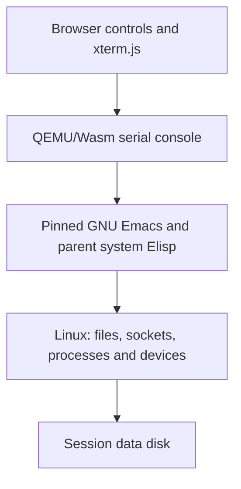

# System architecture

emacsOS makes GNU Emacs the user's programming and operating environment on a
small Linux system. The browser is the primary presentation target. Standard
Elisp APIs remain the public interface; Linux and runtime libraries supply
actual file, network and process behavior.

## Selected route

Boot an Alpine Linux virtual-machine kernel and a minimal userspace with
BusyBox init, musl and GNU Emacs built from the pinned 30.2 fork. Init remains
PID 1 to reap children and coordinate shutdown. One trusted Emacs runs as
UID 1000 and opens the interactive environment. The parent supplies system
Elisp and the browser console. No desktop environment or host terminal server
is needed.

The previous custom C kernel, syscall adapter and cooperative application
framework have been removed. Linux owns memory management, filesystem and
device implementation, scheduling and OS processes. Future work concentrates
on browser display, keyboard input, session lifecycle and Emacs workflows.

## Shared system, distinct delivery profiles

Both profiles boot the same Linux kernel, small initramfs and read-only
SquashFS runtime disk. Initramfs contains the boot tools and fixed-machine
driver dependencies. `/usr` is mounted from the second virtio disk before
Emacs starts, so the guest reads runtime files as needed instead of unpacking
the full installation during every boot. The disk contains a matching Emacs
executable, portable dump, installed Lisp and data from one build. Lisp sources
with bytecode partners and Info manuals are losslessly compressed; uncompiled
startup sources remain directly loadable. `system/packages.lock` pins the guest package closure;
`system/build-packages.lock` pins the compiler closure. The base container is
digest-pinned. Package availability still depends on Alpine repositories;
byte-identical rebuilding is not claimed.

| Profile | Devices and data | Evidence boundary |
| --- | --- | --- |
| Native QEMU | 1 GiB RAM, COM1, virtio home disk, user-mode network | Real guest acceptance including clean two-boot retention and synchronous HTTPS |
| Browser QEMU/Wasm | 1 GiB RAM, COM1, fresh virtio session disk, network disabled | Browser boot, keyboard, file and lifecycle acceptance; no storage retention or networking claim |

A template disk is copied into each browser machine's memory. Guest writes do
not mutate the served template or the native user's disk. Refreshing creates
a fresh machine and discards that copy. Native writes target a separate
host-backed disk and are tested across orderly shutdown and reopening.

## Responsibilities and trust

| Component | Owns |
| --- | --- |
| Linux and installed libraries | Hardware support, memory, filesystems, sockets, OS process execution and errors |
| BusyBox init and parent boot policy | Mounts, account/session startup, child reaping and shutdown |
| GNU Emacs | Evaluation, buffers, command loop and standard file/process/network APIs |
| Parent system Elisp | Welcome workspace and user-facing workflows |
| Browser | Terminal rendering/input, loading feedback, machine controls and errors |

An external worker has a separate Linux address space. That does not sandbox
applications sharing a UID or turn buffers into independent processes.
Non-returning Lisp, garbage collection or a blocking C operation can still
stall the main Emacs. No application isolation, enforced resource quotas,
multi-user policy or real-time response guarantee is claimed.

The browser observes readiness and exit diagnostics on the real serial
stream. It does not implement application behavior in JavaScript. The HTTP
server serves allowlisted static assets only; it has no terminal-server,
upload or command-execution endpoint.

## Persistence and networking

Native retention means a normal Emacs save followed by guest synchronization,
successful home-disk unmount, QEMU poweroff and reopening the same disk. It
establishes neither power-loss durability nor crash recovery. Browser
retention requires a separate synchronization and export/store/reopen design.

Native networking uses QEMU's user backend. Browser guest networking is
disabled until an explicit transport is implemented and accepted. Browser
fetches of system assets are host presentation activity. HTTPS additionally
requires the runtime feature and certificate validation; having a socket API
alone proves neither. Async HTTPS needs its own acceptance rather than being
inferred from a synchronous request.

## Next focus

Prioritize reliable browser boot, clear status, keyboard/focus behavior and a
usable workspace. Follow with retained user files and browser transport, each
with explicit failure and lifetime contracts. Keep system policy outside the
Emacs fork and introduce new frameworks only for concrete application needs.
