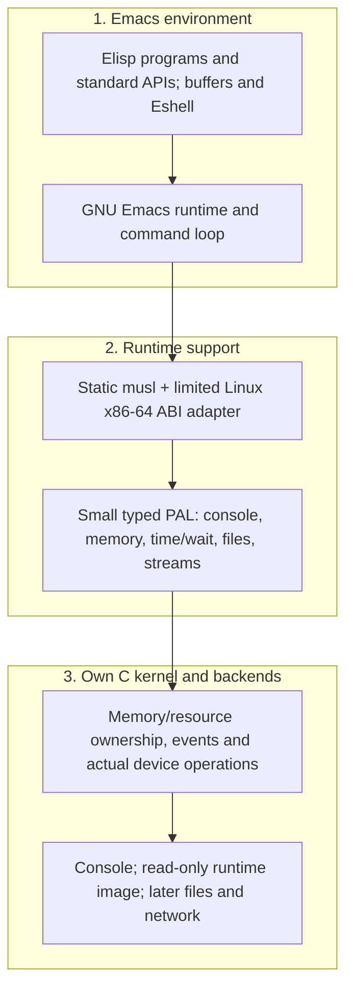

# System architecture

emacsOS aims to make GNU Emacs the machine's programming and operating
environment. Standard Elisp APIs are the public interface; file and network
backends supply actual capabilities. This document selects an architecture for
the first port. It does not implement that port.

## Current source and proposed system

The current parent contains a BIOS loader, x86-64 entry, a C kernel that polls
COM1 for output, and build/launcher tools. The entry identity-maps only the first
2 MiB; the kernel prints a message and halts with interrupts disabled. GNU Emacs
30.2 is an unchanged source dependency apart from provenance documentation.
Emacs does not execute here. There is no PAL, syscall handler, allocator,
executable loader, input/event loop, file backend or network stack.

The following diagram describes the **proposed** system, not present execution:



These are three functional responsibilities, with named implementation pieces;
they do not require three new frameworks or independently isolated components.

## First-port decision

Use a statically linked GNU Emacs with musl, served by a limited Linux x86-64
syscall compatibility adapter in our own kernel. The PAL sits below that
adapter and defines backend semantics. This is a bounded compatibility target,
not a Linux kernel, full Linux userspace or general Unix process environment.
The decision remains subject to actual E0 runtime validation.

The initial build profile is terminal-only, using interpreted and bytecompiled
Lisp. GUI, native compilation, Lisp threads, TLS and external helpers are
deferred; P1 freezes the exact configure options and dependency versions.
Functions remaining in a build still need a backend or explicit unsupported
behavior; the profile does not imply all unsupported functions disappear.

This route retains upstream libc/runtime startup and reduces the initial Emacs
port surface. It still requires executable loading, startup-stack/TLS setup,
memory operations, readable runtime files, terminal behavior and event waits.
A generic read/write interface cannot replace them. A direct Emacs C platform
port or replacement libc is deferred because it expands the initial integration
and maintenance work. See [runtime-port requirements](runtime-port.md).

The adapter translates syscall arguments, descriptors and error numbers into
PAL operations. It must not hide unsupported behavior with success-only stubs.
Kernel/backends expose typed operations without Linux syscall layouts; the
adapter consumes those operations. New Elisp wrappers are unnecessary when
standard functions can use the supported runtime path.

## Layer ownership

| Responsibility | Owns | Does not imply |
| --- | --- | --- |
| Emacs environment | Standard Elisp APIs, evaluation, buffers, loading, conditions, command loop and tool clients. | A backend because its function exists; OS processes because a connection object exists. |
| Runtime support | Static musl startup, bounded ABI translation and typed PAL capability/error/lifetime contracts. | Full Linux compatibility, replacement libc or a generic resource broker. |
| Own kernel/backends | Real memory/device access, resource tables, bounds and readiness delivery. | Protection, scheduling or durability before those mechanisms exist. |

Kernel, adapter and future PAL code belong to the parent repository. Necessary
Emacs runtime changes belong to the pinned fork. Future system Elisp and its
tests belong to the parent. Build-time placement inside installed Emacs Lisp
does not change source ownership; see [source layout](source-layout.md).

## Capability contracts

Start with the capabilities needed before interactive Emacs; grow typed file
and network operations from working backends. Exact C signatures, numeric ABI
assignments and handle representation are finalized in P1.

| Capability | Required semantics |
| --- | --- |
| Console | Byte input/output, partial transfer, terminal attributes needed by Emacs, readiness and real device errors. |
| Memory | Available/reserved ranges; aligned allocations/maps with explicit size, lifetime, release and failure rules; define any supported protection semantics honestly. |
| Time/wait | Monotonic time, absolute deadlines, readiness sets, timeout and interruption outcomes; define wake/recheck behavior. |
| Runtime files | Read-only lookup, metadata, open/read/seek/map or a documented equivalent sufficient for executable, dump, Lisp and data loading. |
| Working files | Later typed file/directory operations, creation flags, offsets, metadata, rename, cleanup and synchronization. |
| Network streams | Later connection setup, pending/connected/failed state, byte I/O, readiness, EOF, timeout and close. |

Share read/write/close/wait conventions where meaningful. Keep directory
iteration, rename and connection setup typed rather than forcing them into a
universal operation bag. Do not add a general resource registry or plugin
framework before these concrete contracts need one.

The following operation families are a **design sketch**, not implemented C
signatures or a committed binary ABI:

```text
console_read / console_write / console_attributes
memory_map / memory_unmap
clock_monotonic / wait_ready(interests, absolute_deadline)
file_open / file_read / file_write / file_seek / file_metadata / file_sync
file_rename / file_remove / directory_open / directory_next
after N0: stream_connect / stream_read / stream_write / stream_status
close_file / close_directory / close_stream
```

Every acquired handle has one recorded owner and defined transfer/duplication
rules. Borrowed buffers remain valid for the operation's documented duration;
asynchronous ownership must be explicit. Events carry identity/generation
sufficient to reject stale events after close or handle reuse. The first port
can keep simple owned synchronous operations and nonblocking readiness rather
than hidden background pointer retention. Bound handle counts and queues;
failed acquisition releases
partial resources.

A positive byte count reports progress and can be shorter than requested.
For a nonzero read request, distinguish zero-byte EOF from would-block and a
real error; a zero-length request alone proves no EOF. No-progress writes need
an explicit would-block/error outcome rather than an infinite retry. The
adapter preserves those distinctions as appropriate Emacs conditions/events.

Close consumes the caller's handle even if final cleanup reports an error;
retrying that same handle is invalid. Duplication, if supported, adds a reference
and only final release destroys the underlying resource. Preserve earlier I/O
failure and separately report final cleanup failure as the documented operation
requires. File close is not inherently a durable-storage guarantee.

## Boot and runtime loading

The planned boot chain is:

1. BIOS loads the kernel; x86-64 entry establishes an adequate memory map and
   stack. The current 2 MiB mapping is insufficient as a runtime plan and must
   be extended deliberately.
2. Kernel initialization accounts for available RAM and reserves page tables,
   kernel sections, stacks, runtime-image backing and future loaded regions.
   Establish console, memory, monotonic time/wait and read-only bootstrap files.
3. Load a supported static Emacs ELF, validating segments, sizes, alignment,
   range arithmetic, overlap and entry placement. Define its initial ABI stack,
   arguments/environment and required libc/TLS startup state.
4. Expose the matching portable dump, Lisp and runtime data through bootstrap
   file operations. A read-only image is required before writable user files;
   it is not a persistent working filesystem.
5. Enter a controlled base initialization that avoids accidental user/site
   startup and reaches the command loop. Only then claim interactive Elisp.

The executable, portable dump, source/version, Lisp and runtime data must come
from a matching build, recorded by an artifact manifest. Source pins alone do
not identify a built runtime. The exact toolchain, dump configuration, image
encoding and controlled startup arguments must be selected and validated during
the port. Do not combine an old dump with new dumped Lisp or a new executable.

## Data and event flow

A future file read follows Elisp file API → Emacs/libc → supported ABI operation
→ typed PAL file operation → backend. Data/count/error returns along that path;
backend limits and original failures remain visible. F0 working files are
explicitly volatile. F1 separately defines disk format, synchronization,
interruption behavior and retained-file validation. A RAM write or successful
close must not be presented as persistence.

Input and connection readiness follow backend → kernel event/wait state → ABI
wait result → Emacs command loop → filters, sentinels or Lisp callbacks. Waiting
must check readiness and arm/recheck without losing events between those steps.
Use level-style readiness that remains observable while its condition holds.
A ready result is a hint to retry the typed nonblocking operation, not ownership
of bytes or proof the next call cannot would-block. Deadlines use monotonic time
and must define units, overflow and timeout ordering.

Callbacks return promptly. A long Lisp computation or C call can delay input,
timers and network handlers; there is no CPU latency or forced-cancellation
guarantee. No new scheduler is required to begin event-driven file/network
programs. An Emacs connection process object, filter or sentinel is not an
independent OS process.

## Trust and failure scope

Initially one trusted Emacs and the kernel share a runtime/address-space design;
the initial shared privileged runtime is not a security boundary. No protected
user process, independent thread execution or fault isolation is
promised. Invalid-pointer checks needed for correctness do not by themselves
supply isolation. A runtime fault can stop the system; explicit errors and
resource cleanup cover only paths that retain control.

Accounts, service managers, durable startup snapshots, scheduling experiments,
protected workers and a browser product are deferred. Do not restore their
previous implementations implicitly. Buffers should be clients of working APIs
when those tools are introduced.

## Decisions and open gates

| Status | Topic | Decision or gate |
| --- | --- | --- |
| Selected, unvalidated | First runtime port | Static Emacs + musl + limited Linux x86-64 ABI adapter over typed PAL; validate through E0. |
| Selected | Public API | Standard Elisp evaluation/file/network APIs; document the supported subset. |
| Selected | Bootstrap ordering | Read-only runtime files and memory/time/wait precede interactive Emacs; working files follow. |
| Open: P1 | Concrete interfaces | C signatures, handle representation, bounds and required ABI operations from the selected runtime build. |
| Open: P1/E0 | Runtime artifacts | Build/toolchain, ELF/startup/TLS details, memory budget, dump manifest and terminal/wait integration. |
| Open: F1 | Durability | Format, synchronization and recovery model after volatile file behavior is correct. |
| Open: N0 | Network transport | Prove native and future Wasm feasibility, including any explicit host bridge, before selecting device/stack. |
| Deferred | Runtime/process changes | Direct libc replacement, preemption, isolation, external processes and service frameworks. |

[The roadmap](roadmap.md) turns these gates into staged work. PAL implementation
and the Emacs port remain future tasks.
